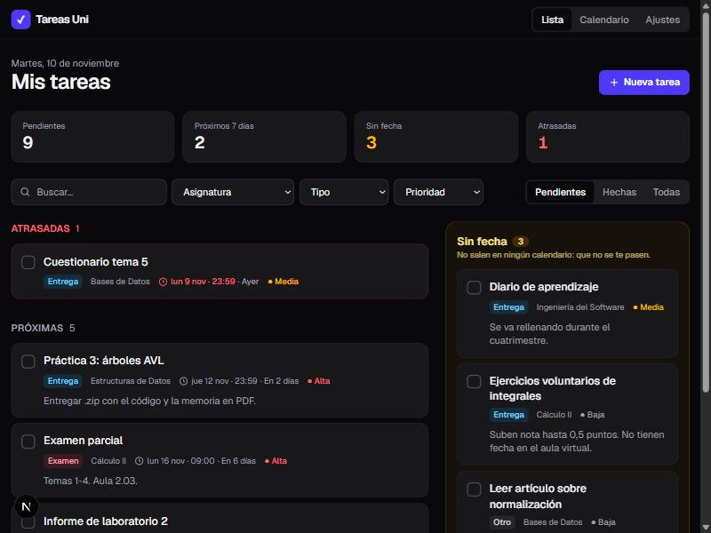
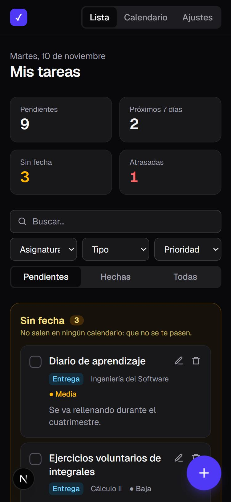
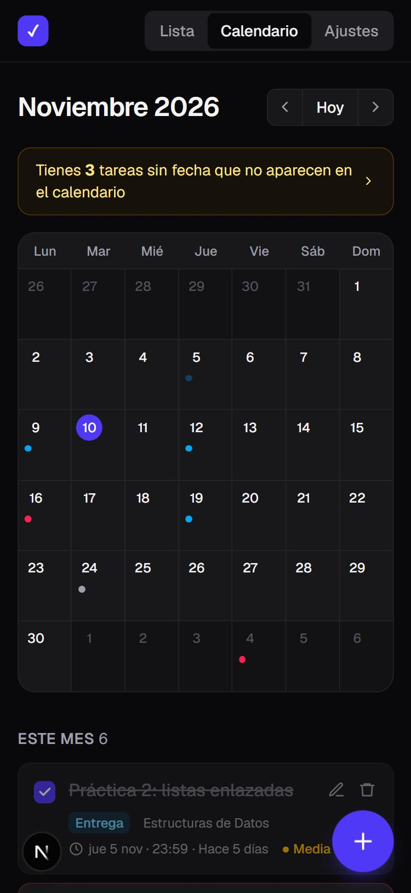
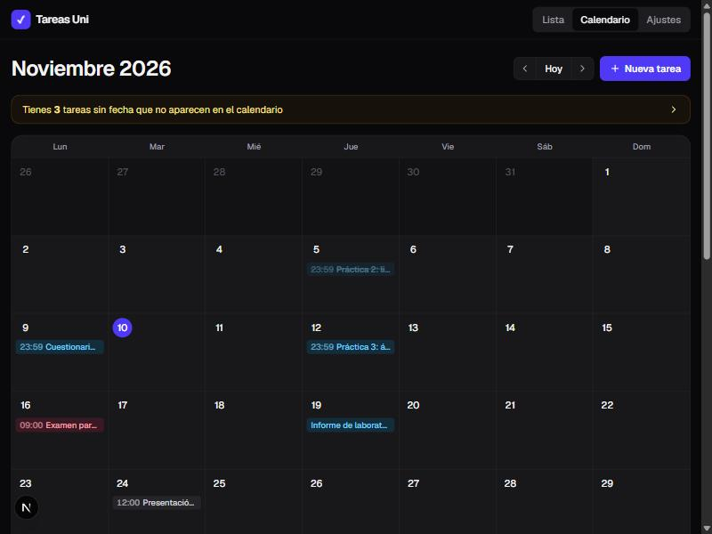

# 📚 Tareas Uni

Gestor personal de tareas, entregas y exámenes de la universidad. Funciona **en local** y se
sincroniza con **Google Tasks** y **Google Calendar**. Así puedes ver tus entregas en el widget del
móvil, al lado de tu horario de clases.

Su punto fuerte: las tareas **sin fecha límite**, que no aparecen en ningún calendario y es fácil
olvidar, tienen su propio panel destacado y también llegan al widget.



<p align="center">
  
  &nbsp;&nbsp;
  
</p>

## ✨ Funcionalidades

- **Tareas sencillas:** título, asignatura, tipo (entrega / examen / otro), fecha y hora
  opcionales y notas. Se pueden crear, editar, borrar y marcar como hechas con un clic.
- **Vista de lista** con búsqueda (no distingue tildes) y filtros por asignatura, tipo y estado.
  Los filtros se guardan en la URL.
- **Secciones** Atrasadas, Próximas y Hechas, y un panel destacado **Sin fecha**.
- **Vista de calendario** mensual. Pulsa un día para crear una tarea en esa fecha.
- **Google Tasks:** todas tus tareas, incluidas las que no tienen fecha, en la lista
  «Universidad». Así las ves en el widget de Android. Si marcas una tarea como hecha en el móvil,
  la app lo detecta al sincronizar.
- **Google Calendar:** las entregas y los exámenes con fecha se convierten en eventos de un
  calendario «Universidad».
- **Diseño responsive** con modo oscuro automático.



## 🛠️ Tecnologías

| | |
|---|---|
| Framework | [Next.js 16](https://nextjs.org) (App Router, Server Actions) + React 19 |
| Lenguaje | TypeScript |
| Estilos | Tailwind CSS 4 |
| Base de datos | SQLite (archivo local) con [Drizzle ORM](https://orm.drizzle.team) + libSQL |
| Google | OAuth 2.0 (`google-auth-library`), Google Tasks API y Google Calendar API |
| Validación | Zod |
| Fechas | date-fns |
| Tests | Vitest |

### Decisiones de diseño

- **¿Por qué SQLite?** Es una app personal que se usa en local. SQLite guarda todo en un único
  archivo (`data/tareas.db`), es gratis y no requiere instalar ningún servidor.
- **¿Por qué Google Tasks para el widget?** La app vive en el PC y el móvil no puede conectarse a
  ella. Google hace de puente: su widget oficial de Tasks funciona sin instalar nada más, y admite
  tareas sin fecha, cosa que un calendario no puede mostrar.
- **Permisos mínimos.** Se usa el scope `calendar.app.created`, que solo permite gestionar el
  calendario que crea la app. Tus otros calendarios, como el del horario, quedan fuera de su
  alcance.
- **Sincronización sin esperas.** Los cambios se envían a Google con `after()`, después de
  responder al navegador. La interfaz no espera a la red, y si falla, el botón «Sincronizar ahora»
  lo arregla.

## 🚀 Instalación

Necesitas [Node.js](https://nodejs.org) 20 o superior.

```bash
git clone https://github.com/ivanmaestresoler/gestor-tareas-uni.git
cd gestor-tareas-uni
npm install
cp .env.example .env
npm run db:seed           # opcional: crea tareas de ejemplo
npm run dev
```

Abre <http://localhost:3000>. La base de datos se crea sola la primera vez que arrancas la app.

> **Windows:** si PowerShell dice que «la ejecución de scripts está deshabilitada», usa
> `npm.cmd run dev` o ejecuta una vez `Set-ExecutionPolicy -Scope CurrentUser RemoteSigned`.

## 🔗 Configurar Google (Tasks + Calendar)

Necesitas crear unas claves gratuitas en Google Cloud y ponerlas en el `.env`. Tienes una guía
paso a paso, con cada pantalla explicada, en **[docs/google-setup.md](docs/google-setup.md)**.

Resumen:

1. Crea un proyecto en [Google Cloud Console](https://console.cloud.google.com) y activa
   **Google Calendar API** y **Google Tasks API**.
2. Configura la pantalla de consentimiento (público externo, tu Gmail como usuario de prueba).
3. Crea un **ID de cliente OAuth** de tipo *Aplicación web*, con la URI de redirección
   `http://localhost:3000/api/google/callback`.
4. Copia el ID y el secreto en `.env` (`GOOGLE_CLIENT_ID`, `GOOGLE_CLIENT_SECRET`) y reinicia.
5. En la app: **Ajustes → Conectar con Google → Sincronizar ahora**.
6. En Android: añade el widget de **Google Tasks** y elige la lista **Universidad**.

## 🎓 Configurar Moodle

🚧 La importación desde Moodle, usando el servicio `moodle_mobile_app`, está planificada pero
todavía no está implementada.

## 📜 Scripts

| Comando | Qué hace |
|---|---|
| `npm run dev` | Arranca la app en modo desarrollo |
| `npm test` | Ejecuta los tests |
| `npm run typecheck` | Comprueba los tipos de TypeScript |
| `npm run lint` | Revisa el código con ESLint |
| `npm run db:seed` | Crea tareas de ejemplo (`-- --reset` para reemplazarlas) |
| `npm run db:generate` | Genera una migración tras cambiar `src/lib/db/schema.ts` |
| `npm run db:studio` | Abre Drizzle Studio para ver la base de datos |

## 📁 Estructura

```
src/
├─ app/
│  ├─ page.tsx               # Lista de tareas
│  ├─ calendario/            # Vista de calendario
│  ├─ ajustes/               # Conexión con Google y opciones
│  └─ api/google/            # Rutas de OAuth (connect y callback)
├─ components/               # Interfaz: tarjetas, formulario, filtros, calendario...
├─ lib/
│  ├─ db/                    # Esquema, conexión y migraciones automáticas
│  ├─ tasks/                 # Validación, filtros, consultas y Server Actions
│  ├─ google/                # OAuth, conversión a Google (mapping) y sincronización
│  ├─ settings.ts            # Ajustes clave/valor guardados en SQLite
│  ├─ calendar.ts            # Lógica de la cuadrícula mensual
│  └─ format.ts              # Formato de fechas en español
└─ instrumentation.ts        # Aplica las migraciones al arrancar
drizzle/                     # Migraciones SQL generadas
docs/                        # Guía de Google y capturas
scripts/seed.mts             # Datos de ejemplo
```

## 🧪 Tests

La lógica importante está en funciones puras, es decir, sin base de datos ni red, y tiene tests
con Vitest: validación de formularios, filtros y orden, tareas atrasadas, cuadrícula del
calendario, conversión de tareas a Google Tasks y Calendar, y resolución de conflictos al
sincronizar.

```bash
npm test
```

## 🗺️ Hoja de ruta

- [x] **Fase 1:** gestor de tareas con lista, filtros, «Sin fecha» y calendario
- [x] **Fase 3:** sincronización con Google Tasks (widget de Android) y Google Calendar
- [ ] **Fase 2:** importar asignaturas y tareas de Moodle (incluidas las que no tienen fecha)

## 🔒 Privacidad

La app está pensada para un único usuario en su propio ordenador y no tiene sistema de login.
Tus claves van en `.env`, y tus datos y el permiso de Google en `data/`. Ninguno de los dos se
sube a Git. Puedes revocar el acceso en cualquier momento desde **Ajustes → Desconectar** o en
<https://myaccount.google.com/permissions>.
